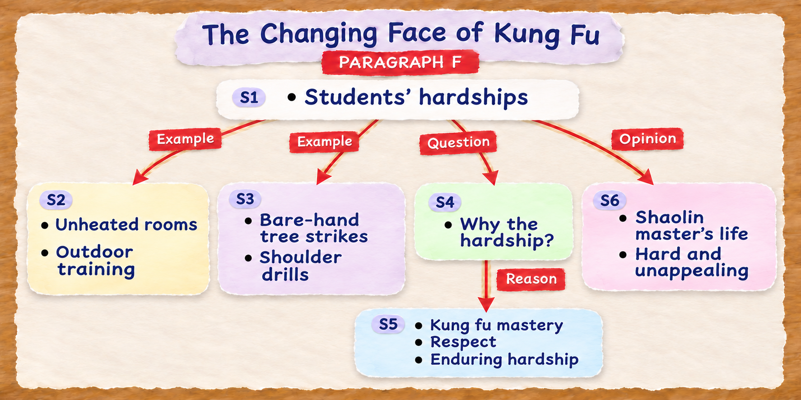

# EvaZhou导图.skill

**面向英语教师和学生的教学赋能产品，把英文段落变成可讲解、可练习、可检查的句间逻辑导图。**

学生能复述每句话，仍可能说不清作者为什么把这些句子放在一起。EVA 导图让学生指着箭头解释：这一句举了哪个观点的例子？这一句回答了哪个问题？结尾是谁的看法？

## 一张导图怎么看



示例来自 Reading Explorer 2, Unit 4B, *The Changing Face of Kung Fu*, Paragraph F。图中文字为关键词摘记。

- **一句一卡。** S2 的无暖气房间和户外训练来自同一句，放在同一张卡内，用两个小黑点列出。
- **一根箭头标一条句间关系。** S2、S3 用 **Example** 对应学生的艰苦生活与训练。S4 提问，S5 用 **Reason** 接回这个问题。
- **观点连回评论对象。** S6 用 **Opinion** 连到艰苦生活这一主题，表达胡师傅对少林师傅生活的看法。

## 用在课堂上

| 环节 | 教师和学生怎么用 | 怎么检查 |
| --- | --- | --- |
| 示范 | 教师展示导图，带学生沿着一根箭头复述两个节点之间的关系。 | 学生能完整说出「第几句对第几句做了什么」。 |
| 独立练习 | 学生先读原文、编号，再用英文关键词做卡片，最后连箭头并标关系。 | 检查要点是否归在正确的句子卡内，箭头是否连到具体观点。 |
| 讲评 | 对照参考导图，选一条有分歧的箭头回原文核对。 | 学生能指出支持这条连线的语义证据，并解释为什么用这个标签。 |

导图优先使用 12 类逻辑块：举例、对比、类比、转折、个人观点、原因、结果、特征描述、流程、讲故事、并列、问题－解决方案。遇到独立问句，可用 **Question** 标出。

## 安装口令

### WorkBuddy

复制到 WorkBuddy 对话框：

```text
请从 https://github.com/zeval66/eva-mind-map/tree/main/skills/eva-mind-map 安装「eva导图.skill」。读取该目录的 SKILL.md，将技能安装到当前 WorkBuddy 的用户级技能目录，目录名用 eva-mind-map。安装后检查 WorkBuddy 能否识别该技能。
```

### Codex

复制到 Codex 对话框：

```text
请用 $skill-installer 安装这个 GitHub 技能：https://github.com/zeval66/eva-mind-map/tree/main/skills/eva-mind-map
```

### 安装后使用

```text
用 eva导图.skill 为下面的英文段落画句间逻辑导图。
［粘贴英文原文］
```
